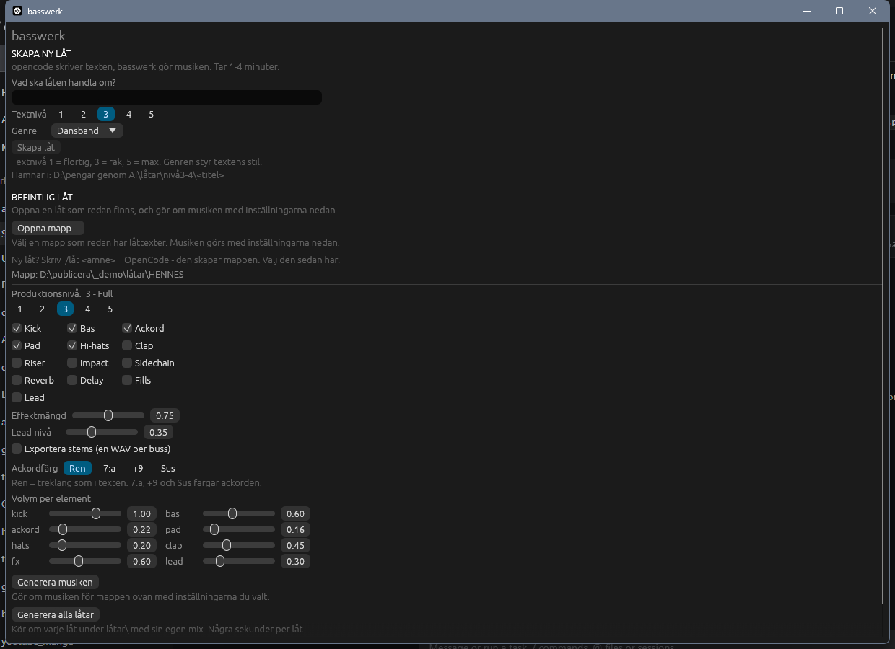

# basswerk

Läser en låttext från `latstruktur-mall`-skillen och **genererar musiken** — helt
utan ljudfiler eller extern ljudmotor. Allt syntetiseras i koden. **v1.**



## Användning

Prova direkt med demolåten i `demo/`:

```sh
cargo run --release -- --gui demo
```

```sh
basswerk <låtmapp> [--out <fil.wav>]
```

```sh
basswerk "låtar\nivå3-4\HENNES MUN"
basswerk "låtar\nivå5\TUNGAN" --out TUNGAN.wav
```

Programmet letar upp `<titel> - låttext.txt` i mappen och skriver musiken till
`ljud\<titel>.wav` i samma mapp. `ljud`-mappen skapas om den inte finns.

Så flödet blir: släng in de tre textfilerna i en mapp, kör programmet, få ut
musiken i `ljud\`.

## Fönster

| Kommando | Vad som händer |
| --- | --- |
| `basswerk` | Fönstret öppnas, ingen mapp vald |
| `basswerk --gui <låtmapp>` | Fönstret öppnas med mappen förvald |
| `basswerk <låtmapp>` | CLI-läget |

Dubbelklickar du på `basswerk.exe` startar fönstret. Där finns filmapp-väljare,
en `Generera`-knapp, info om låten, en strukturlista och en knapp som öppnar
resultatet i din vanliga spelare. Du kan också **släppa en mapp i fönstret**.

Genereringen körs i en bakgrundstråd, så fönstret svarar hela tiden.

`basswerk.exe` är statiskt länkad och väger ~13 MB — flytta den vart du vill,
ingen installation behövs.

## Bygga

Kräver Rust (stable).

```sh
cargo build --release
```

Binären hamnar i `target\release\basswerk.exe`. Beroendena är `eframe` (fönstret),
`rfd` (filväljaren) och `rodio` (uppspelningen) — resten är standardbiblioteket.
Första bygget hämtar crates från crates.io, därefter går det att bygga offline.

## Vad den läser ur filen

| Ur filen | Används till |
| --- | --- |
| `TEMPO:` | taktlängd (`240 / BPM`) |
| `KEY:` | grundton och dur/moll |
| `TOTAL LÄNGD:` | längd (annars räknas den ur takterna) |
| `[INTRO] 8 takter \| 0:00 - 0:13` | sektioner, taktantal, starttid |
| `Ackord: Em - C - G - D` | ackordföljd per sektion |
| `(2 takter/ackord)` | hur länge varje ackord ligger |
| `[KICK] [BAS] [RISER] …` | mixnoter — styr vilka element som spelar |

## Produktionsnivåer

Nivån är en snabbstart som fyller i elementen. Ändrar du en kryssruta manuellt
blir nivån **"Egen"**.

| Nivå | Namn | Element |
| --- | --- | --- |
| 1 | Skiss | Kick, Bas |
| 2 | Grund | + Hi-hats |
| 3 | Full | + Ackord, Pad |
| 4 | Prod | + Clap, Riser, Impact, Sidechain |
| 5 | Max | + Reverb, Delay, Fills, Lead |

Valet sparas i `ljud\installning.txt` tillsammans med två rattar:

| Ratt | Spann | Standard | Styr |
| --- | --- | --- | --- |
| **Effektmängd** | 0,00 – 1,50 | 0,75 | hur mycket som skickas till reverb och delay |
| **Lead-nivå** | 0,00 – 1,00 | 0,35 | volymen på plocklagret i drops |

## Genrer

Sex val: Raggardunk, Dansband, Techno, Trap, Synthwave, Hårdrock.

Genren skickas med i prompten och **styr även ljudet**. Den läses från
`Genre:`-raden i låttexten — så du kan byta genre på en befintlig låt genom att
ändra den raden och köra `Generera musiken` igen.

| Genre | Bas | Kick | Pad | Hi-hats | Kick-botten |
| --- | --- | --- | --- | --- | --- |
| Raggardunk | 1,0× | 1,0× | 1,0× | 1,0× | 48 Hz |
| Dansband | **1,8×** | 1,15× | 1,4× | 0,5× | **38 Hz** |
| Techno | 1,0× | 1,15× | 0,5× | **1,3×** | 52 Hz |
| Trap | 1,4× | 0,85× | 0,8× | **1,5×** | 45 Hz |
| Synthwave | 1,1× | 0,95× | **1,6×** | 0,7× | 55 Hz |
| Hårdrock | 1,2× | **1,2×** | 0,6× | 1,2× | 55 Hz |

Preseten är **multiplikatorer ovanpå buss-rattarna** — drar du ner `bas` till 0,5
med Dansband valt blir resultatet 0,5 × 1,8 = 0,9. Genren är en utgångspunkt,
inte ett lås.

## Batch-läge

Knappen **Generera alla låtar** kör om varje låt under `låtar\` i tur och
ordning, med var sin egen mix. Statusraden visar `3/8 NAMN` medan den jobbar.
Fallerar en låt stannar den där och rapporterar vilken.

## Skapa ny låt i fönstret

Överst finns **SKAPA NY LÅT**: skriv ett ämne, välj textnivå och genre, tryck
**Skapa låt**. Fönstret startar då `opencode run` som skriver texten enligt
skillen, hittar den nya mappen och genererar musiken. Tar 1–4 minuter.

Genren skickas med i prompten och styr både text och ljud (se Genrer ovan).

## Volym per element

Åtta rattar under "BEFINTLIG LÅT": kick, bas, ackord, pad, hats, clap, fx, lead.
De sparas per låt som `gain_<namn>` i `ljud\installning.txt`.

OBS: stem-filerna skrivs **före** masterns mjukbegränsare. Drar du en buss över
~1,0 kan den därför klippa i sin egen stem-fil även om mastern låter rent.

## Var inställningarna bor

| Fil | Innehåll |
| --- | --- |
| `%APPDATA%\basswerk\installning.txt` | Arbetsmapp, modell, opencode-sökväg, genre, textnivå |
| `<låt>\ljud\installning.txt` | Produktionsnivå, element, effekter, buss-volymer, stems |

## Fills och lead

**Fills** är en virvelroll som accelererar genom sista takten av varje pre-chorus
och landar rakt i droppet. Ligger på clap-bussen, men styrs av egen kryssruta.

**Lead** är ett plocklager som bara spelar i drops. Första droppet får en gles
figur (fjärdedelar), andra och tredje en tätare (åttondelar) — det är variationen
som gör att reprisen inte låter som en kopia.

CLI motsvarighet:

```sh
basswerk "låtar\nivå3-4\HENNES MUN" --niva 5
```

## Effekter

Reverb och delay ligger som **send-bussar**: pad, ackord, clap, fx och hats
skickas iväg, medan kick och bas alltid går torra. Det gör att effekterna hörs
mest i glesa partier — intro, brygga, outro — och minst i täta drops.

## Loudness

Utdata normaliseras till en målnivå (RMS-baserat närmevärde för loudness, −13
dBFS) och mjukbegränsas sedan mot ett tak på −1 dBFS. Det gör att nivåerna blir
jämförbara — tidigare sänkte en enstaka topp hela mixen.

## Vad den genererar

| Element | Hur |
| --- | --- |
| **Kick** | sinus med fallande tonhöjd (143 → 48 Hz), snabb avklingning |
| **Subbas** | ren sinus ur ackordets grundton, tre oktaver ner |
| **Ackordstab** | tre detunade sågtänder, kort envelope |
| **Pad** | mjuka sinustoner, långsam in- och utfasning |
| **Hi-hat** | högpassat brus, öppen på sista slaget i takten |
| **Clap** | brusburst med flam — bara i drop |
| **Riser** | brus som växer, sista två takterna av pre-chorus |
| **Impact** | dov smäll som markerar varje drop |

Arrangemanget styrs av sektionstypen: intro tunt med kick från takt 5, vers
normal, pre-chorus med riser och **kicken borta sista två takterna**, drop fullt
ös med clap, brygga nästan tom, outro som tonar ut.

## Utdata

WAV, 44100 Hz, stereo, 16-bit PCM. Normaliseras till 0,89 i topp och tonas ut
sista 1,2 sekunderna.

## Filstruktur

```
src/
├── main.rs        CLI och sammanfattning
├── gui.rs         fönstret (eframe/egui)
├── load.rs        mapp -> Song
├── header.rs      tempo, tonart, längd
├── sections.rs    sektionsblock, mixnoter, textrader
├── chords.rs      tonnamn, ackord, taktantal
├── model.rs       datamodell
├── arrange.rs     sektioner -> slag och noter
├── synth.rs       kick, bas, stab, pad
├── perc.rs        clap, hat, riser, impact
├── dsp.rs         oscillatorer, brus, filter
└── wav.rs         stereobuffer och WAV-export
```

## Stems

Kryssa i **Exportera stems** (eller kör `--stems`) och du får en WAV per buss i
`ljud\stems\`:

```
kick  bas  ackord  pad  hats  clap  fx  lead  reverb  delay
```

Effektreturerna skrivs separat, så en DAW kan återskapa mastern genom att bara
summera filerna. Stem-filerna är **inte** loudness-normaliserade — de ligger på
sina råa nivåer så att du kan mastra själv.

```sh
basswerk "låtar\nivå3-4\HENNES MUN" --stems
```

## Uppspelning

Knapparna **Spela** och **Stopp** i fönstret spelar WAV-filen direkt i appen
(rodio/cpal). **Öppna i spelare** skickar den till din vanliga spelare i stället.

## Inte än

- Ingen sång eller röst — texten läses in men används inte. Avfört efter test:
  inbyggd modell på 1–3 GB klarar inte uppgiften (se `VAGKARTA.md`)
- Ingen tidslinje eller vågform i fönstret
- Ingen per-låt-omskrivning av texten — bara musiken kan köras om
- Genre-preseten styr bara nivåer och kick-tonhöjd, inte själva syntesen

